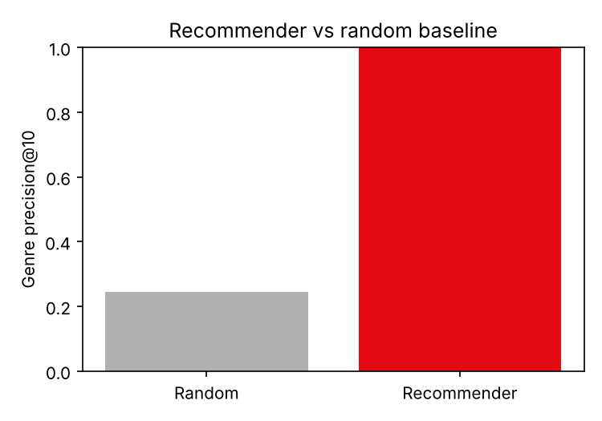
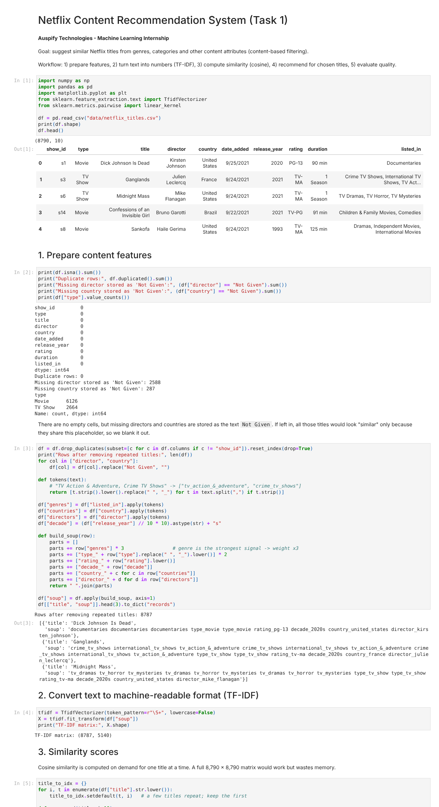
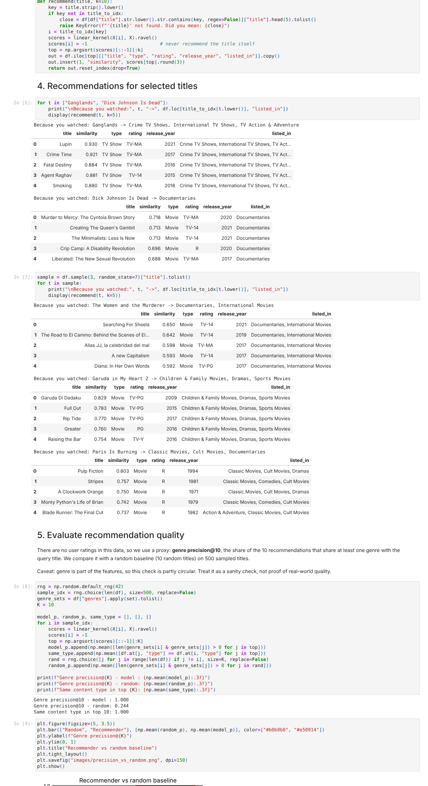
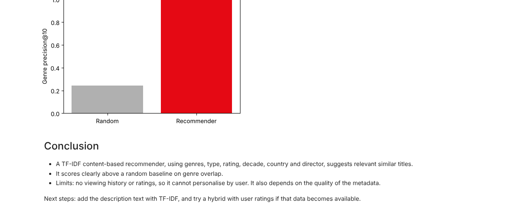

# Netflix Content Recommendation System

Task 1 of the **Auspify Technologies Machine Learning Internship**.

A content-based recommender that suggests similar Netflix titles from genres, type, rating, release decade, country and director.

## How it works

1. **Prepare features** - clean the data, turn the `Not Given` placeholders into blanks, and combine genre, type, rating, decade, country and director into one text "soup" per title. Genres are weighted x3 because they carry the strongest signal.
2. **Vectorize** - convert the soup into numbers with TF-IDF (Scikit-Learn).
3. **Similarity** - cosine similarity between a title's vector and all others.
4. **Recommend** - `recommend("Ganglands", k=5)` returns the top similar titles.
5. **Evaluate** - genre precision@10 against a random baseline on 500 sampled titles.

## Results

| Metric (500 sampled titles, top 10) | Value |
|---|---|
| Genre precision@10 - recommender | 1.000 |
| Genre precision@10 - random baseline | about 0.24 |
| Same content type (Movie / TV Show) | 1.000 |

Genre is part of the features, so this check is partly circular. It confirms the system behaves sensibly but does not prove real-world quality, because there are no user ratings in the data.



## Screenshots

Screenshots of the executed notebook (features, recommendations and evaluation):





## Run it

```bash
pip install -r requirements.txt
jupyter notebook netflix_recommender.ipynb
```

## Files

- `netflix_recommender.ipynb` - full workflow with outputs
- `data/netflix_titles.csv` - dataset (8,790 rows, 10 columns)
- `images/` - evaluation chart
- `screenshots/` - screenshots of the executed notebook

## Skills used

Recommendation systems, NLP fundamentals (TF-IDF), feature engineering, Scikit-Learn.

## Possible improvements

Add the description text, build a hybrid model with user ratings, and evaluate with user feedback.

#Auspify #AuspifyTechnologies #AuspifyInternship #AuspifyProjects
